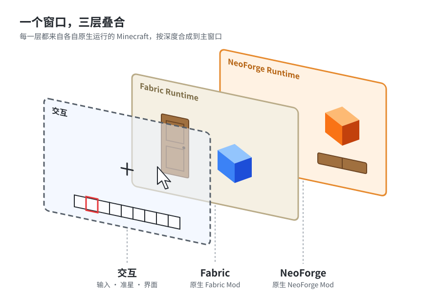
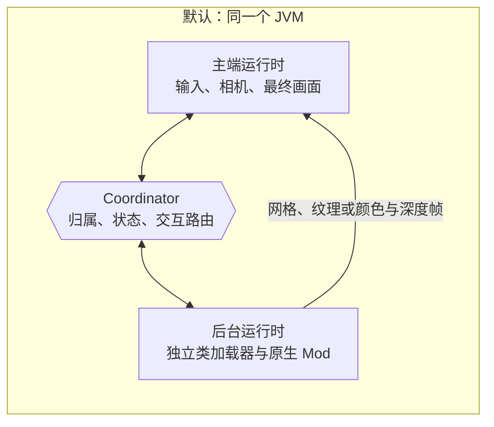
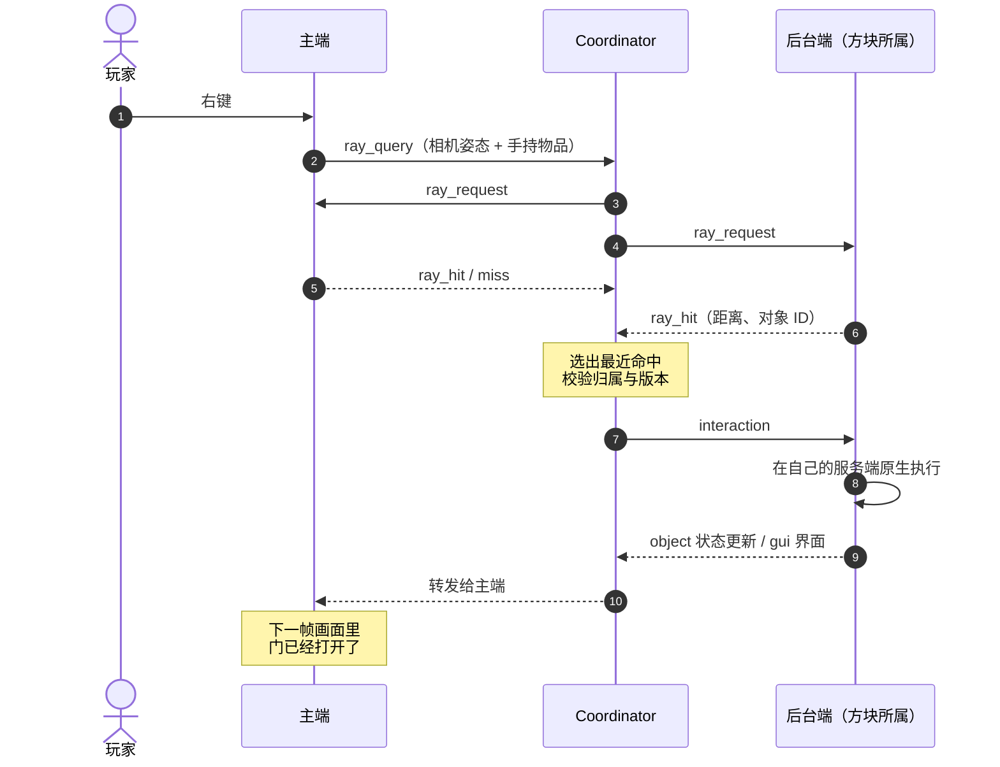

<div align="center">


# MMLF · Multi-ModLoader Fusion


*Native Execution · Shared Logical World · Unified Interaction · Composited Rendering*


[它是什么](#about) · [效果](#features) · [如何体验](#try) · [从源码运行](#quick-start) · [工作原理](#how-it-works) · [已知限制](#limitations) · [路线图](#roadmap)

</div>

<p align="center">
  
</p>

---

<a id="about"></a>

## 💡 它是什么

Fabric 和 NeoForge 是两套互不兼容的 Mod 加载器，转译类方案（如 Sinytra Connector）需要在同一个进程里调和两边的 API 与类加载，深度修改原版的 Mod 往往难以转译。

**MMLF 的思路是保留每个加载器自己的原生运行环境**，由协作层同步状态和路由交互。两个运行时放在同一个 JVM 中，用隔离的类加载器分别启动（Demo 1.0 发行版仍是两个独立进程）。它们仍是各自独立的 Minecraft 世界，并不是把两套加载器合并成一套 API。

- 🎮 **主端**负责玩家输入、相机和最终画面；另一个运行时在后台执行自己的 Mod。
- 🔀 **Coordinator** 管理对象归属并路由交互；方块由所属运行时执行原生逻辑。
- 🖼️ 开发版默认使用统一渲染层：后台传输网格和纹理，由主端统一绘制（远端方块也能吃到主端光影）；未覆盖的内容回退到颜色与深度帧合成。Demo 1.0 发行版仍是纯画面合成。

> 下方的 Demo 1.0 安装说明对应现有发行版。Demo V2 的统一渲染已在开发测试场景中验证，尚未在真实游玩的存档中验证。

---

<a id="features"></a>

## ✨ 能做到什么

| | 功能 | 说明 |
|:-:|---|---|
| 🧱 | **同屏显示** | Fabric 与 NeoForge 的原生方块、第三方 Mod 内容同时出现，前后遮挡正确，原版世界不会重复绘制 |
| 👆 | **原生交互** | 点击、破坏、中键选取另一端的方块，由**方块所属端原生执行**——状态变化、挥手、声音、破坏粒子都是原汁原味 |
| 🔁 | **双向事件** | 两端的测试 Mod 可以互相发送事件，联动对方的方块 |
| 🚶 | **跨端碰撞** | 玩家会被另一端的方块挡住，被另一端的生物推开 |
| 🧟 | **跨端实体（开发版）** | 另一端世界里的生物可以被攻击、右键交互（如村民交易界面），由它所属的一端原生执行；它对玩家造成的伤害转给主端的玩家 |
| ✋ | **原生手持渲染** | 另一端物品的手持模型和快捷栏图标，由它所属的一端原生渲染 |
| 🍲 | **远端原生界面** | 右键另一端 Mod 的方块（如 Farmer's Delight 厨锅），直接打开它的**原生 GUI**，鼠标键盘可操作，下方是主窗口玩家自己的物品栏 |
| 🎒 | **统一物品栏** | 另一端的物品按原标签页出现在创造模式物品栏；生存模式下放置、挖掘、捡起都由所属端执行，数量与掉落同步回来 |
| 🔄 | **任一端可当主窗口** | 启动哪个客户端，哪个就是主窗口；另一端在后台自动拉起并隐藏，主窗口关闭后几秒内自动退出 |
| ⚡ | **跨端红石与容器** | 两端的 Mod 方块互相传递红石信号，主窗口的拉杆、红石线、比较器能控制或读取另一端的 Mod 方块；另一端的 Mod 能读到旁边的原版方块；漏斗能向另一端的容器送入或取出物品，不复制、不丢失。跨端信号最多晚 1 tick |

---

<a id="try"></a>

## 🎮 如何体验（Demo 1.0）

不需要构建，用你平时的启动器就能玩。发行版是两个 Mod JAR，各放进一个版本即可：

| 文件 | 放进 |
|---|---|
| `mmlf-fabric-1.0.0-demo.jar` | Minecraft 1.21.1 **Fabric** 版本的 `mods` |
| `mmlf-neoforge-1.0.0-demo.jar` | Minecraft 1.21.1 **NeoForge** 版本的 `mods` |

从 [Releases](https://github.com/xiaozhe19/mmlf/releases) 页面下载；也可以自己构建：`./gradlew.bat release`，产物在 `build/release/`。

### 1. 在同一个启动器里装好两个版本

支持 **PCL**、**HMCL** 和 **官方启动器**（其他启动器会被拒绝）。在**同一个** `.minecraft` 下安装：

- Minecraft 1.21.1 + Fabric Loader（≥ 0.16.10），并放入 [Fabric API](https://modrinth.com/mod/fabric-api)
- Minecraft 1.21.1 + NeoForge 21.1.x

> [!IMPORTANT]
> 两个版本的 `mods` 必须分开：PCL / HMCL 请开启**版本隔离**（默认开启），Mod 放在 `.minecraft/versions/<版本名>/mods`。官方启动器请把每个安装配置的「游戏目录」设为 `.minecraft/versions/<版本名>`。
>
> 每个版本先单独启动一次，让启动器补全文件。

### 2. 放入 MMLF 和你想融合的 Mod

把两个 MMLF JAR 分别放进对应版本的 `mods`。其他 Mod 照常放进它所属加载器的版本里，例如：

- Fabric 版本：[Macaw's Doors](https://modrinth.com/mod/macaws-doors)、[Tom's Simple Storage](https://modrinth.com/mod/toms-storage)
- NeoForge 版本：[Macaw's Trapdoors](https://modrinth.com/mod/macaws-trapdoors)、[Farmer's Delight](https://modrinth.com/mod/farmers-delight)

### 3. 启动其中任意一个

1. 启动 Fabric 或 NeoForge 版本，它就是主窗口。左上角的状态面板会显示另一端的启动进度（查找版本 → 检查模组 → 后台启动），另一端的窗口始终隐藏。
2. 进入任意**单人**存档。另一端会在后台打开一个同名、同种子的影子世界；加载期间主窗口会暂停并显示进度，就绪后自动继续（也可以点「直接进入」先玩）。
3. 用两边 Mod 的物品建造、交互，两个加载器的内容出现在同一个画面里。关闭主窗口后，后台一端几秒内自动退出。

**可以试试：** 创造模式物品栏里能找到另一端的物品；右键 Farmer's Delight 厨锅或 Tom's Storage 终端打开另一端的原生界面；开关两边的门和活板门。

<details>
<summary><b>🩺 出问题了？</b></summary>

- 另一端启动失败时，主窗口会弹出错误界面，给出原因和日志位置，可选择「继续（不使用远端）」。
- 日志在主端游戏目录的 `mmlf/sessions/session-*/` 下（`manager.log`、`<fabric|neoforge>.log`）；后台一端的游戏目录和影子世界在 `mmlf/<fabric|neoforge>/`。
- 常见原因：另一个加载器的版本没装或文件不全、对端 `mods` 里缺少 MMLF JAR、两个版本的 Minecraft 版本不一致。
- 两个运行时会同时运行，请确认内存和显存足够；同 JVM 模式共享进程的堆上限。

</details>

> [!WARNING]
> Demo 1.0 是早期演示版：只支持单人世界（多人服务器中另一端停在标题画面）；发行版目前主要在 PCL 上测试过，官方启动器和 HMCL 尚未完整验证；影子世界只同步种子和平地/普通类型，改变地形生成的 Mod 或数据包会导致两端原版地形不一致。另见[已知限制](#limitations)。

---

<a id="quick-start"></a>

## 🛠️ 从源码运行（开发场景）

### 环境要求

| 项目 | 要求 |
|---|---|
| 操作系统 | Windows 10 / 11（Java 代码不依赖平台，其他系统未测试） |
| Java | 64 位 JDK 21 |
| 显卡 | 支持 OpenGL 3.2。两个运行时和图形资源仍有明显开销；开发场景曾在笔记本 RTX 3060 上运行 |
| 网络 | 首次构建需下载 Minecraft 官方开发依赖 |

### 构建与启动

```powershell
# 构建并运行自动化测试
./gradlew.bat build

# 构建发行版 JAR，产物在 build/release/
./gradlew.bat release

# 直接启动任意一端：它成为主窗口，并在同一个 JVM 中拉起另一端
./gradlew.bat :fabric-bridge:runClient
./gradlew.bat :neoforge-bridge:runClient
```

> [!NOTE]
> 启动后主窗口会显示「等待其他 Runtime」。后台世界加载完成（约 1–3 分钟）后，会自动进入同一个创造模式平地世界，出生点附近两侧各有一个测试方块：蓝色属于 Fabric 测试 Mod，橙色属于 NeoForge 测试 Mod。不想等可以点「直接进入」。

开发会话默认使用统一渲染和地形接入。需要对照时，可在环境变量 `MMLF_EXPERIMENTS` 中加入 `no_terrain`（只关地形接入）或 `no_geometry_replay`（退回画面合成）。第三方 Mod 不入库；需要时放进项目的 `mmlf/mods/`，或用 `MMLF_MODS_DIR` 指定目录。

---

<a id="how-it-works"></a>

## 🔧 工作原理



两个运行时各自保有自己的类加载器、世界和原生 Mod；运行时之间在 JVM 内交接消息和渲染数据。统一渲染层默认启用：后台提交静态网格、动态内容和所需纹理；主端绘制可识别的内容，不能覆盖的部分仍通过远端画面合成。地形接入（默认开启）把远端静态网格交给主端自己的区块渲染器，因此光影包会把它们当作本地地形处理；远端方块变化时只重建变化的 section。

一次「点击另一端方块」的完整路径：



<details>
<summary><b>📡 通信</b></summary>

- 运行时之间通过 JVM 内共享的 JDK 类型（字符串帧、内存或内存映射的帧通道）交接消息和渲染数据，互不共享类加载器。
- 控制与交互由 Coordinator 路由，并按会话和对象归属校验。
- 每个方块对象有唯一 ID 和所属 Runtime，**只有所属端能修改它的权威状态**；Coordinator 会拒绝伪造来源、过期或不属于自己的命中。

</details>

<details>
<summary><b>🎞️ 帧传输（画面合成兜底 / Demo 1.0）</b></summary>

- 后台在世界画完、画手之前，把颜色和深度读进 **PBO**，不阻塞渲染。
- GPU 栅栏通过后，用**非阻塞槽锁 + CRC32 校验**写进三槽共享帧文件。
- 每帧的元数据（含后台**实际**渲染时的相机和投影矩阵）写在槽头，主端直接轮询，不经消息通知。

</details>

<details>
<summary><b>🎨 合成与重投影（画面合成兜底 / Demo 1.0）</b></summary>

- 主端在世界画完后画一个全屏三角形，片元着色器写出远端表面在当前相机下的深度，交给**硬件深度测试**与主端自己的深度缓冲比较遮挡。
- 远端帧姿态与当前相机不一致时，沿视线**对数步进 + 二分**做重投影；遇到被揭开的遮挡区域直接丢弃该像素，不产生拖影。

</details>

<details>
<summary><b>🧹 去重 · ⏱️ 延迟补偿 · 🎯 交互 · 🗂️ 会话</b></summary>

- **去重**：每一端只渲染自己拥有的方块（区块构建时过滤）；后台不画云和方块选择框，原版世界只由主端画。
- **延迟补偿**（画面合成兜底）：后台以 1.25 倍视野渲染，按源端转动速度和实测延迟预测相机朝向，帧率上限 120。
- **交互**：主端点击时向所有 Runtime 发射线查询，每一端回答自己最近的方块或实体，Coordinator 选出最近命中并校验归属，交给所属端原生执行。
- **实体**：所属端定期上报自己实体的位置和大小，主端据此让玩家被推开；所属端里玩家副本受到的伤害一律不生效，由它的实体造成的伤害转给主端的玩家。
- **会话**：`SessionHost` 创建会话目录和 Coordinator，按 Mod 元数据把第三方 JAR 分到对应加载器，再启动各 Runtime。后台窗口从创建起就隐藏；主端退出时广播会话结束，并在关闭窗口前停止后台运行时。

</details>

---

## 📁 项目结构

```
mmlf/
├── common/              协议消息、会话、共享帧文件、日志（纯 Java，带单元测试）
├── coordinator/         Coordinator：注册、路由、射线仲裁、世界与实体索引
├── launcher/            SessionHost（会话、Mod 分拣、启动 Runtime）与独立启动器
├── bridge-common/       两个加载器共用的 Bridge 与 Mixin（编译进各自的 Bridge）
├── fabric-bridge/       Fabric 入口与构建配置
├── neoforge-bridge/     NeoForge 入口、专用 Mixin 与构建配置
├── fabric-test-mod/     Fabric 原生测试 Mod（蓝色方块）
├── neoforge-test-mod/   NeoForge 原生测试 Mod（橙色方块）
└── gradle/              Gradle Wrapper 与客户端运行配置
```

运行时还会用到以下本地目录，均不入库：`mmlf/mods/`（开发用第三方 Mod）、`config/`（可选的场景配置，缺省时使用内置的两块测试方块）、`runtime/`（每次会话的游戏目录与日志）。

> 只想构建、测试不依赖 Minecraft 的核心模块（`common` / `coordinator` / `launcher`）时，加 `-PcoreOnly` 即可跳过所有 Mod 模块。

---

## ⚙️ 配置

**环境变量 `MMLF_EXPERIMENTS`**（逗号分隔）：统一渲染相关项默认开启，用 `no_terrain`、`no_geometry_replay`、`no_geometry` 逐级关闭；其余实验项（如 `probe`、`small_view`）默认关闭，写上名字才开启。

<details>
<summary><b>JVM 系统属性</b>（客户端托管模式下加在 <code>runClient</code> 的运行配置里）</summary>

| 属性 | 默认 | 作用 |
|---|---|---|
| `mmlf.autohost` | `true` | 没有会话时，由本客户端托管会话并拉起另一端 |
| `mmlf.compositor` | GPU | 设为 `cpu` 使用旧的 CPU 合成，作为对照 |
| `mmlf.overscan` | `1.25` | 后台视野放宽倍数；自适应模式下作为上限 |
| `mmlf.adaptiveOverscan` | `false` | 实验性动态视野放宽（质量与快速转向效果待验证） |
| `mmlf.poseLeadMs` | `25` | 无延迟反馈时，后台相机预测的默认提前量（ms） |
| `mmlf.reprojectionDiagnostic` | `false` | 显示重投影诊断颜色，仅供调试 |
| `mmlf.backgroundFps` | `120` | 后台帧率上限 |
| `mmlf.selfTest` | `false` | 托管会话时运行自测（也可用 `MMLF_SELF_TEST=true`） |

</details>

<details>
<summary><b>🩺 日志与排错</b></summary>

- 最新会话目录记录在 `runtime/latest-session.txt`。会话目录下：
  - `logs/*.jsonl` —— 各端的结构化日志
  - `clients.log` / `<runtime>.log` —— 客户端完整输出
- 关键指标：
  - 主端定期记录 `metrics/remote_frame`（帧龄、角度差分位数与校准误差）
  - 后台记录 `metrics/capture_latency`
  - 各端定时记录 `metrics/runtime`（CPU、内存、FPS、往返时间）
- **构建报 `mappings.jar`「另一个程序正在使用此文件」**：通常是 IDE 的 Gradle 守护进程占用了 Loom 缓存。关闭 IDE 或执行 `./gradlew.bat --stop` 后重试。

</details>

---

<a id="limitations"></a>

## ⚠️ 已知限制

> **开发中的 V2 状态**：统一渲染和地形接入默认开启，远端方块光影和快速操作远端活板门的卡顿已在开发测试场景中验证通过；**尚未在真实游玩的存档中验证**（区块数量、已有地形、性能表现）。

| 状态 | 限制 |
|:-:|---|
| 🔴 | **快速转头时屏幕边缘的远端物体会被裁切**，之后可见重新出现。两端同时渲染时显卡吃紧：默认窗口下远端帧龄 P50 约 12 ms；最大化到 2560×1351 时后台帧率从约 134 降到约 60，帧龄 P50 约 28 ms、P95 最高约 43 ms，裁切和抖动更明显 |
| 🟠 | 远端半透明内容（水、玻璃、粒子）按不透明处理：主端的半透明表面会挡住后面的远端物体；远端蒸汽等粒子会混入天空色并遮挡其后的主端方块 |
| ⚪ | 暂不支持：跨端物品持久化（Phase 3）、实体的完整物理同步、Forge 作为第三端。远端界面中主窗口独有的物品显示为屏障占位 |
| ⚪ | 暂不支持三类跨端 Mod 联动：两端物品混用的配方、把一端的物品用在另一端的方块上、Mod 之间专门写的兼容代码（如附属 Mod）。 |

---

<a id="roadmap"></a>

## 🛣️ 路线图

- [x] **Phase 1** — 双端同屏渲染、深度合成、跨端交互与碰撞
- [x] **Phase 2** — 跨 Runtime 原生 GUI、统一物品栏、任一端可当主窗口
- [x] 统一渲染与地形接入：远端方块吃到主端光影、远端变化按 section 差量重建（开发测试场景验证）
- [ ] 在真实游玩的存档中双方向验证效果与性能，通过后发布 Demo V2
- [ ] 缓解残余画面合成中的快速转头裁切
- [ ] 单个 Bootstrap Mod JAR + Runtime Manager：丢进普通 `mods` 文件夹即可用
- [ ] 原生按键转发（由所属端客户端执行点击），手部与 HUD 分层
- [ ] 加入 Forge 作为第三个 Runtime（协议层已按多对等 Runtime 设计）
- [ ] **Phase 3** — 跨端物品持久化

---

## 🙏 致谢与声明

- 合成与重投影思路参考了 [rehan-remade/universal-modder](https://github.com/rehan-remade/universal-modder) 中的 Minecraft × GTA V passthrough 示例（MIT License），代码按 Minecraft 1.21.1 的 OpenGL 重新实现。
- 演示用第三方 Mod 均来自 Modrinth，本仓库**不重新分发**：
  - Sketch Macaw 的 [Macaw's Doors](https://modrinth.com/mod/macaws-doors) 与 [Macaw's Trapdoors](https://modrinth.com/mod/macaws-trapdoors)
  - vectorwing 的 [Farmer's Delight](https://modrinth.com/mod/farmers-delight)
  - tom5454 的 [Tom's Simple Storage](https://modrinth.com/mod/toms-storage)
- 顶部图标：Fabric logo 来自 [FabricMC/fabricmc.net](https://github.com/FabricMC/fabricmc.net)（[CC BY-NC-SA 4.0](https://creativecommons.org/licenses/by-nc-sa/4.0/)），NeoForged logo 来自 [neoforged/websites](https://github.com/neoforged/websites)（[CC BY 4.0](https://creativecommons.org/licenses/by/4.0/)），均未修改，归各自项目所有。本项目与 FabricMC、NeoForged 均无官方关联。
- Minecraft 属于 Mojang Studios / Microsoft。本项目不包含、也不分发任何 Minecraft 游戏文件。
- 本项目使用 Claude Code 开发。

<div align="center">
<sub>如果这个思路让你觉得有意思，欢迎点个 ⭐</sub>
</div>
