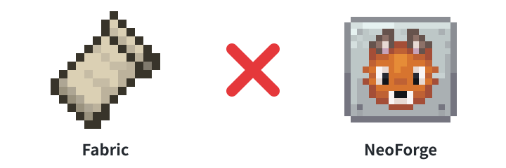
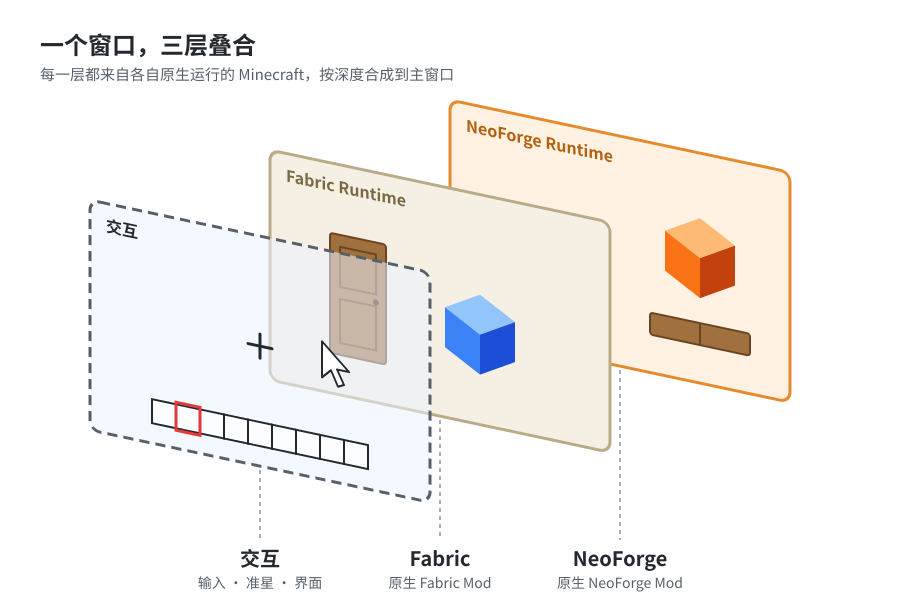
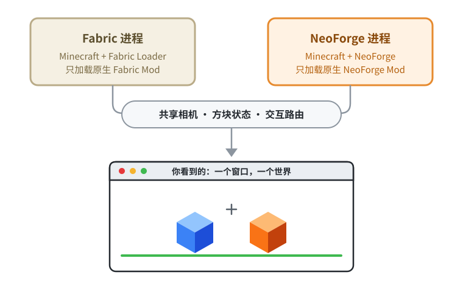
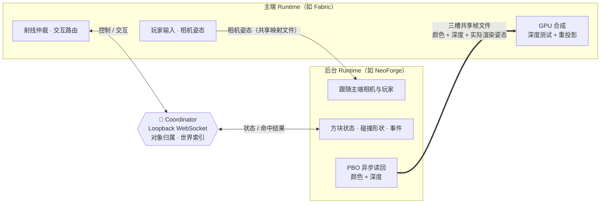
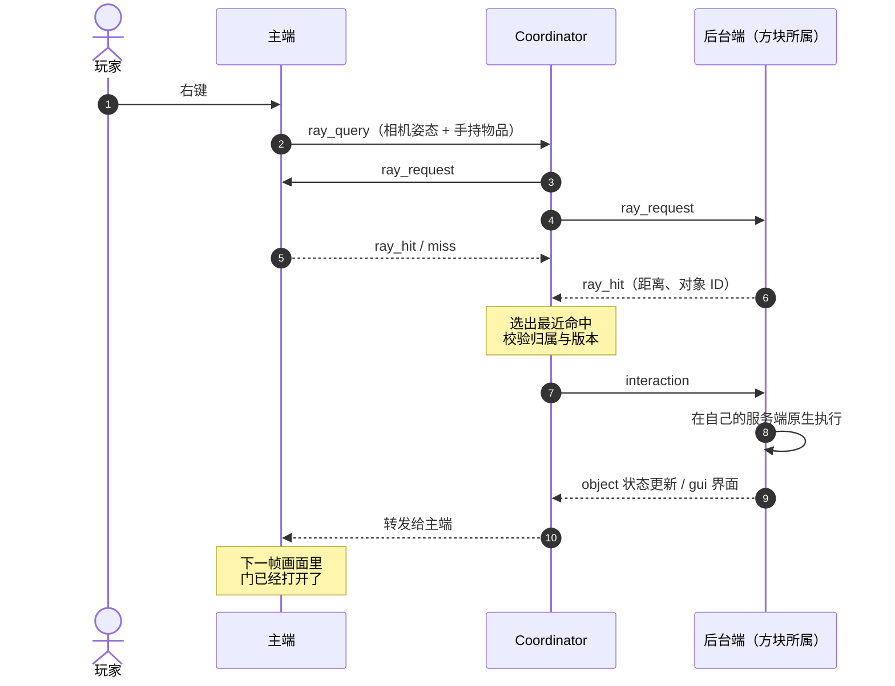

<div align="center">


# 🧩 MMLF · Multi-ModLoader Fusion

**让 Fabric Mod 和 NeoForge Mod 出现在同一个 Minecraft 画面里 。**



*Native Execution · Shared Logical World · Unified Interaction · Composited Rendering*


[它是什么](#about) · [效果](#features) · [快速开始](#quick-start) · [工作原理](#how-it-works) · [已知限制](#limitations) · [路线图](#roadmap)

</div>

<p align="center">
  
</p>

---

<a id="about"></a>

## 💡 它是什么

Fabric 和 NeoForge 是两套互不兼容的 Mod 加载器，转译类方案（如 Sinytra Connector）需要在同一个进程里调和两边的 API 与类加载，深度修改原版的 Mod 往往难以转译。

**MMLF 换了个思路：干脆不让它们待在同一个进程里。**

<p align="center">
  
</p>

- 🎮 **主窗口**负责玩家输入和相机，把相机姿态共享出去
- 🔀 **Coordinator** 在进程间路由方块状态和交互，谁拥有方块，谁说了算
- 🖼️ 后台进程渲染出的**真实画面（颜色 + 深度）**被合成进主窗口，遮挡关系正确

> 画面全部来自各自真实运行的 Minecraft。没有复制另一端的资源，没有重新注册另一端的方块，也没有重写另一端的渲染逻辑。

---

<a id="features"></a>

## ✨ 能做到什么

| | 功能 | 说明 |
|:-:|---|---|
| 🧱 | **同屏显示** | Fabric 与 NeoForge 的原生方块、第三方 Mod 内容同时出现，前后遮挡正确，原版世界不会重复绘制 |
| 👆 | **原生交互** | 点击、破坏、中键选取另一端的方块，由**方块所属端原生执行**——状态变化、挥手、声音、破坏粒子都是原汁原味 |
| 🔁 | **双向事件** | 两端的测试 Mod 可以互相发送事件，联动对方的方块 |
| 🚶 | **跨端碰撞** | 玩家会被另一端的方块挡住 |
| ✋ | **原生手持渲染** | 另一端物品的手持模型和快捷栏图标，由它所属的一端原生渲染 |
| 🍲 | **远端原生界面** | 右键另一端 Mod 的方块（如 Farmer's Delight 厨锅），直接打开它的**原生 GUI**，鼠标键盘可操作，下方是主窗口玩家自己的物品栏 |
| 🎒 | **统一物品栏** | 另一端的物品按原标签页出现在创造模式物品栏；生存模式下放置、挖掘、捡起都由所属端执行，数量与掉落同步回来 |
| 🔄 | **任一端可当主窗口** | 启动哪个客户端，哪个就是主窗口；另一端在后台自动拉起并隐藏，主窗口关闭后几秒内自动退出 |

---

<a id="quick-start"></a>

## 🚀 快速开始

### 环境要求

| 项目 | 要求 |
|---|---|
| 操作系统 | Windows 10 / 11（脚本为 PowerShell；Java 代码不依赖平台，其他系统未测试） |
| Java | 64 位 JDK 21 |
| 显卡 | 支持 OpenGL 3.2。两个客户端同时渲染，越强越好（笔记本 RTX 3060 测试通过） |
| 网络 | 首次构建需下载 Minecraft 官方开发依赖 |

### 三步运行

```powershell
# 1️⃣ 下载演示用第三方 Mod（固定版本，来自 Modrinth，SHA-512 校验）
./scripts/fetch-demo-mods.ps1

# 2️⃣ 构建并运行自动化测试
./gradlew.bat build

# 3️⃣ 启动！-Primary 选择谁当主窗口（默认 fabric）
./scripts/run-demo.ps1 -Primary neoforge
```

也可以直接启动任意一端，它会成为主窗口并在后台拉起另一端：

```powershell
./gradlew.bat :fabric-bridge:runClient
./gradlew.bat :neoforge-bridge:runClient
```

> [!NOTE]
> 启动后主窗口会显示「等待其他 Runtime」。后台世界加载完成（约 1–3 分钟）后，会自动进入同一个创造模式平地世界。不想等可以点「直接进入」。

### 🗺️ 演示场景

出生点附近已经摆好了一组物体（配置见 [`config/demo-scene.json`](config/demo-scene.json)）：

| 物体 | 位置 | 所属端 |
|---|---|:-:|
| 🟦 蓝色测试方块 | x = -1 | Fabric 测试 Mod |
| 🟧 橙色测试方块 | x = 1 | NeoForge 测试 Mod |
| 🚪 橡木四格门 | x = -3 | Macaw's Doors · Fabric |
| 🪟 橡木四格活板门 | x = 3 | Macaw's Trapdoors · NeoForge |
| 📦 GUI 测试方块 / 箱子方块 | z = -3 一排 | 两端测试 Mod 各一组 |
| 🗄️ 箱子 + Tom's Storage 终端 | x = -6 ~ -4, z = -3 | Fabric |
| 🔥 灶台 + 厨锅 | x = 4, z = -3 | Farmer's Delight · NeoForge |

**可以试试：**

- 空手右键测试方块，看另一种颜色的方块跟着联动
- 开关门和活板门
- 走进远端方块，感受碰撞
- 中键选取远端物品，放到地上
- 左键破坏远端方块
- 右键厨锅 / 存储终端，打开另一端的原生界面

### 🤖 自动自测

```powershell
./scripts/run-demo.ps1 -SelfTest

# 或客户端托管模式
$env:MMLF_SELF_TEST='true'; ./gradlew.bat :neoforge-bridge:runClient
Remove-Item Env:MMLF_SELF_TEST   # 测完记得清掉
```

主窗口会自动转向、交互、截图，并输出 `MMLF ... SELFTEST ... passed=true` 之类的结果。

---

<a id="how-it-works"></a>

## 🔧 工作原理



一次「点击另一端方块」的完整路径：



<details>
<summary><b>📡 通信</b></summary>

- 相机姿态、世界帧、远端手部/图标画面都经**本地内存映射文件**传递，主端轮询最新快照。
- 控制与交互走 **Loopback WebSocket**：会话令牌握手、心跳、断线检测。
- 每个方块对象有唯一 ID 和所属 Runtime，**只有所属端能修改它的权威状态**；Coordinator 会拒绝伪造来源、过期或不属于自己的命中。

</details>

<details>
<summary><b>🎞️ 帧传输</b></summary>

- 后台在世界画完、画手之前，把颜色和深度读进 **PBO**，不阻塞渲染。
- GPU 栅栏通过后，用**非阻塞槽锁 + CRC32 校验**写进三槽共享帧文件。
- 每帧的元数据（含后台**实际**渲染时的相机和投影矩阵）写在槽头，主端直接轮询，不经 WebSocket 通知。

</details>

<details>
<summary><b>🎨 合成与重投影</b></summary>

- 主端在世界画完后画一个全屏三角形，片元着色器写出远端表面在当前相机下的深度，交给**硬件深度测试**与主端自己的深度缓冲比较遮挡。
- 远端帧姿态与当前相机不一致时，沿视线**对数步进 + 二分**做重投影；遇到被揭开的遮挡区域直接丢弃该像素，不产生拖影。

</details>

<details>
<summary><b>🧹 去重 · ⏱️ 延迟补偿 · 🎯 交互 · 🗂️ 会话</b></summary>

- **去重**：每一端只渲染自己拥有的方块（区块构建时过滤）；后台不画云和方块选择框，原版世界只由主端画。
- **延迟补偿**：后台以 1.25 倍视野渲染，按源端转动速度和实测延迟预测相机朝向，帧率上限 120。
- **交互**：主端点击时向所有 Runtime 发射线查询，Coordinator 选出最近命中，交给方块所属端在它的服务端原生执行。
- **会话**：`SessionHost` 创建会话目录和 Coordinator，按 Mod 元数据把 `mmlf/mods/` 里的 JAR 分到对应加载器，再启动各 Runtime。后台窗口从创建起就隐藏；主端退出时广播会话结束，后台还有看门狗监测主端进程。

</details>

---

## 📁 项目结构

```
mmlf/
├── common/              协议消息、会话、共享帧文件、日志（纯 Java，带单元测试）
├── coordinator/         WebSocket Coordinator：注册、路由、射线仲裁、世界索引
├── launcher/            SessionHost（会话、Mod 分拣、启动 Runtime）与独立启动器
├── bridge-common/       两个加载器共用的 Bridge 与 Mixin（编译进各自的 Bridge）
├── fabric-bridge/       Fabric 入口与构建配置
├── neoforge-bridge/     NeoForge 入口、专用 Mixin 与构建配置
├── fabric-test-mod/     Fabric 原生测试 Mod（蓝色方块）
├── neoforge-test-mod/   NeoForge 原生测试 Mod（橙色方块）
├── mmlf/mods/           统一 Mod 目录（第三方 JAR 不入库，由脚本下载）
├── config/              演示场景
├── scripts/             run-demo.ps1 · fetch-demo-mods.ps1
└── runtime/             每次会话的游戏目录、帧文件与日志（不入库）
```

> 只想构建、测试不依赖 Minecraft 的核心模块（`common` / `coordinator` / `launcher`）时，加 `-PcoreOnly` 即可跳过所有 Mod 模块。

---

## ⚙️ 配置

**`run-demo.ps1` 参数**

| 参数 | 可选值 | 说明 |
|---|---|---|
| `-Primary` | `fabric`（默认）\| `neoforge` | 谁当主窗口 |
| `-SelfTest` | 开关 | 运行自动自测 |
| `-Foreground` | 开关 | 前台运行启动器 |
| `-LogLevel` | `DEBUG`（默认）\| `INFO` \| `WARN` \| `ERROR` | 日志级别 |

<details>
<summary><b>JVM 系统属性</b>（客户端托管模式下加在 <code>runClient</code> 的运行配置里）</summary>

| 属性 | 默认 | 作用 |
|---|---|---|
| `mmlf.autohost` | `true` | 没有会话时，由本客户端托管会话并拉起另一端 |
| `mmlf.compositor` | GPU | 设为 `cpu` 使用旧的 CPU 合成，作为对照 |
| `mmlf.overscan` | `1.25` | 后台视野放宽倍数；自适应模式下作为上限 |
| `mmlf.adaptiveOverscan` | `false` | 实验性动态视野放宽（质量与快速转向效果待验证） |
| `mmlf.poseLeadMs` | `25` | 无延迟反馈时，后台相机预测的默认提前量（ms） |
| `mmlf.reprojectionDiagnostic` | `false` | 显示重投影诊断颜色，仅供调试 |
| `mmlf.backgroundFps` | `120` | 后台帧率上限 |
| `mmlf.selfTest` | `false` | 托管会话时运行自测（也可用 `MMLF_SELF_TEST=true`） |

</details>

<details>
<summary><b>🩺 日志与排错</b></summary>

- 最新会话目录记录在 `runtime/latest-session.txt`。会话目录下：
  - `logs/*.jsonl` —— 各端的结构化日志
  - `clients.log` / `<runtime>.log` —— 客户端完整输出
- 关键指标：
  - 主端定期记录 `metrics/remote_frame`（帧龄、角度差分位数与校准误差）
  - 后台记录 `metrics/capture_latency`
  - 各端定时记录 `metrics/runtime`（CPU、内存、FPS、往返时间）
- **构建报 `mappings.jar`「另一个程序正在使用此文件」**：通常是 IDE 的 Gradle 守护进程占用了 Loom 缓存。关闭 IDE 或执行 `./gradlew.bat --stop` 后重试。

</details>

---

<a id="limitations"></a>

## ⚠️ 已知限制

| 状态 | 限制 |
|:-:|---|
| 🔴 | **快速转头时屏幕边缘的远端物体会被裁切**，之后可见重新出现。两端同时渲染时显卡吃紧：默认窗口下远端帧龄 P50 约 12 ms；最大化到 2560×1351 时后台帧率从约 134 降到约 60，帧龄 P50 约 28 ms、P95 最高约 43 ms，裁切和抖动更明显 |
| 🟠 | 远端半透明内容（水、玻璃、粒子）按不透明处理：主端的半透明表面会挡住后面的远端物体；远端蒸汽等粒子会混入天空色并遮挡其后的主端方块 |
| ⚪ | 暂不支持：跨端物品持久化（Phase 3）、实体与完整物理同步、Forge 作为第三端。远端界面中主窗口独有的物品显示为屏障占位 |

---

<a id="roadmap"></a>

## 🛣️ 路线图

- [x] **Phase 1** — 双端同屏渲染、深度合成、跨端交互与碰撞
- [x] **Phase 2** — 跨 Runtime 原生 GUI、统一物品栏、任一端可当主窗口
- [ ] 缓解快速转头裁切：降低后台分辨率，或在快速转头时按需同步
- [ ] 单个 Bootstrap Mod JAR + Runtime Manager：丢进普通 `mods` 文件夹即可用
- [ ] 原生按键转发（由所属端客户端执行点击），手部与 HUD 分层
- [ ] 加入 Forge 作为第三个 Runtime（协议层已按多对等 Runtime 设计）
- [ ] **Phase 3** — 跨端物品持久化

---

## 🙏 致谢与声明

- 合成与重投影思路参考了 [rehan-remade/universal-modder](https://github.com/rehan-remade/universal-modder) 中的 Minecraft × GTA V passthrough 示例（MIT License），代码按 Minecraft 1.21.1 的 OpenGL 重新实现。
- 演示用第三方 Mod 均由 `scripts/fetch-demo-mods.ps1` 从 Modrinth 下载并校验，本仓库**不重新分发**：
  - Sketch Macaw 的 [Macaw's Doors](https://modrinth.com/mod/macaws-doors) 与 [Macaw's Trapdoors](https://modrinth.com/mod/macaws-trapdoors)
  - vectorwing 的 [Farmer's Delight](https://modrinth.com/mod/farmers-delight)
  - tom5454 的 [Tom's Simple Storage](https://modrinth.com/mod/toms-storage)
- 顶部图标：Fabric logo 来自 [FabricMC/fabricmc.net](https://github.com/FabricMC/fabricmc.net)（[CC BY-NC-SA 4.0](https://creativecommons.org/licenses/by-nc-sa/4.0/)），NeoForged logo 来自 [neoforged/websites](https://github.com/neoforged/websites)（[CC BY 4.0](https://creativecommons.org/licenses/by/4.0/)），均未修改，归各自项目所有。本项目与 FabricMC、NeoForged 均无官方关联。
- Minecraft 属于 Mojang Studios / Microsoft。本项目不包含、也不分发任何 Minecraft 游戏文件。
- 本项目使用 Claude Code 开发。

<div align="center">
<sub>如果这个思路让你觉得有意思，欢迎点个 ⭐</sub>
</div>
