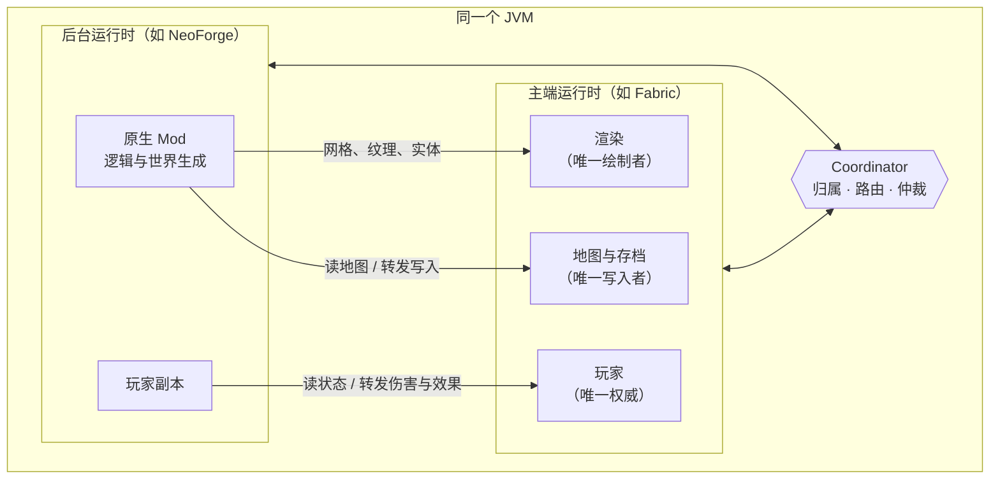
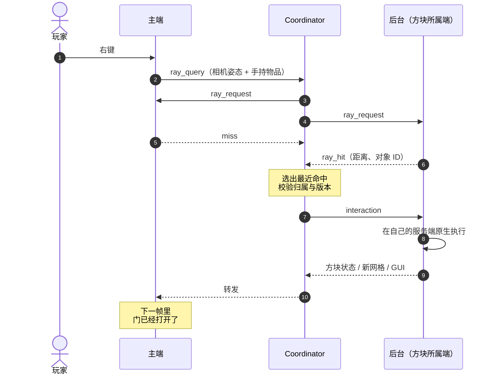

<div align="center">


# MMLF · Multi-ModLoader Fusion


*Native Execution · Shared World · Unified Interaction*


[它是什么](#about) · [效果](#features) · [如何体验](#try) · [从源码运行](#quick-start) · [工作原理](#how-it-works) · [已知限制](#limitations) · [路线图](#roadmap)

</div>

---

<a id="about"></a>

## 💡 它是什么

**MMLF 用过让每个加载器在自己的原生环境里运行，再把世界、玩家和画面合成一份这样的方法来尝试解决模组加载器相互兼容的问题。** 两个 Minecraft 运行时放在同一个 JVM 里，各自用隔离的类加载器启动，各自加载自己的 Mod；协作层把它们接成一个游戏：

- 🗺️ **一份地图**：两个ModLoader MC实例同时编辑一份地图
- 🧍 **一个玩家**：两个ModLoader MC实例共享一个玩家状态
- 🖼️ **一次绘制**：画面全部由主端绘制。后台只提交网格和纹理，远端方块进入主端自己的地形渲染管线，光影包会把它们当作本地地形处理。
- 🔀 **原生执行**：点击、破坏、红石、容器、实体交互都交给**方块或实体所属的一端**原生执行，再把结果同步回来。

> 两个加载器的 Mod 仍各自运行在自己的 Minecraft 里，MMLF 没有把两套 API 合并成一套。两端的 Mod 不能直接调用对方的代码，见[已知限制](#limitations)。

---

<a id="features"></a>

## ✨ 能做到什么

| | 功能 | 说明 |
|:-:|---|---|
| 🗺️ | **一份地图、一份存档** | 主端是地图唯一的写入者；后台对地图的修改转给主端执行。后台的数据存进主端存档目录下的 `mmlf/`，两端在同一个保存点一起保存 |
| ⛏️ | **后台 Mod 的世界生成** | 后台 Mod 的矿石、野生作物、地物（如 Create 锌矿、Farmer's Delight 野生作物）生成进主端地图，不与原版方块重叠 |
| 🎨 | **统一渲染** | 两端的方块、实体、手持物品由主端一次画出，前后遮挡正确；远端方块进入主端地形管线，光影包下有正确的光照与阴影；远端方块变化时只重建变化的区块段 |
| 🧍 | **一个玩家** | 生命、饥饿、氧气、药水效果以主端为准；后台 Mod 的食物、效果和伤害作用在主端玩家身上；后台独有的效果也显示在主端 HUD 上 |
| 👆 | **原生交互** | 点击、破坏、中键选取另一端的方块，由方块所属端原生执行，状态变化、声音、粒子与原版一致；对着空气使用另一端的物品（吃、喝、投掷）也会交给物品所属端 |
| 🧟 | **跨端实体** | 另一端的生物可以被攻击、交易（打开另一端的原生交易界面）；它们会被主端的墙挡住、随主端的光照变暗；它们对玩家的伤害和经验转给主端玩家 |
| 🍲 | **远端原生界面** | 右键另一端 Mod 的方块（如 Farmer's Delight 厨锅），直接打开它的**原生 GUI**，鼠标键盘可操作，下方是主端玩家自己的物品栏 |
| 🎒 | **统一物品栏** | 另一端的物品按原标签页出现在创造模式物品栏；生存模式下放置、挖掘、捡起由所属端执行，数量与掉落同步回来 |
| ⚡ | **跨端红石与容器** | 两端的 Mod 方块互相传递红石信号；主端的拉杆、红石线、比较器能控制或读取另一端的 Mod 方块；漏斗能向另一端的容器送入或取出物品，不复制、不丢失。跨端信号最多晚 1 tick |

---

<a id="try"></a>

## 🎮 如何体验（Demo V3）

Release中下载，放进对应版本的mods文件夹中

| 文件 | 放进 |
|---|---|
| `mmlf-fabric-3.0.0-demo.jar` | Minecraft 1.21.1 **Fabric** 版本的 `mods` |
| `mmlf-neoforge-3.0.0-demo.jar` | Minecraft 1.21.1 **NeoForge** 版本的 `mods` |

### 1. 在同一个启动器里装好两个版本

支持 **PCL**、**HMCL** 和 **官方启动器**。在**同一个** `.minecraft` 下安装：

- Minecraft 1.21.1 + Fabric Loader（≥ 0.16.10），并放入 [Fabric API](https://modrinth.com/mod/fabric-api)
- Minecraft 1.21.1 + NeoForge 21.1.x

> [!IMPORTANT]
> 两个版本的 `mods` 必须分开：PCL / HMCL 请开启**版本隔离**（默认开启），Mod 放在 `.minecraft/versions/<版本名>/mods`。官方启动器请把每个安装配置的「游戏目录」设为 `.minecraft/versions/<版本名>`。
>
> 每个版本先单独启动一次，让启动器补全文件。

### 2. 放入 MMLF 和你想融合的 Mod

把 MMLF JAR 分别放进对应版本的 `mods`。其他 Mod 照常放进它所属加载器的版本里。

### 3. 启动其中任意一个

1. 启动 Fabric 或 NeoForge 版本，它就是主窗口。左上角的状态面板显示另一端的启动进度（查找版本 → 检查模组 → 后台启动），另一端的窗口始终隐藏。
2. 进入任意**单人**存档（新建或已有）。加载期间主窗口会暂停并显示进度，就绪后自动继续。
3. 用两边 Mod 的物品建造、交互。关闭主窗口时，后台一起退出。

**可以试试：** 新建一个世界，在洞穴里找 Create 的锌矿、在草地上找 Farmer's Delight 的野生作物；在创造模式物品栏里找另一端的物品；右键厨锅或 Tom's Storage 终端打开另一端的原生界面；吃另一端的食物，看主端的饥饿值变化；开启光影包，看远端方块的阴影。

<details>
<summary><b>🩺 出问题了？</b></summary>

- 另一端启动失败时，主窗口会弹出错误界面，给出原因和日志位置，可选择「继续（不使用远端）」。
- 日志在主端游戏目录的 `mmlf/sessions/session-*/` 下；后台一端的游戏目录在 `mmlf/<fabric|neoforge>/`。
- 后台的世界数据在 `<存档>/mmlf/<fabric|neoforge>/`。备份、复制、删除存档时它会跟着一起走；不装 MMLF 打开这个存档时，这个文件夹会被忽略但保留。
- 常见原因：另一个加载器的版本没装或文件不全、对端 `mods` 里缺少 MMLF JAR、两个版本的 Minecraft 版本不一致。
- 两个运行时共用一个进程的内存上限，请在启动器里给足内存（建议 ≥ 6 GB），并确认显存足够。

</details>

> [!WARNING]
> Demo V3 仍是演示版：只支持单人世界；后台 Mod 的生物不会自然刷出，后台 Mod 的结构不会生成；两端 Mod 不能直接联动对方的代码。另见[已知限制](#limitations)。

---

<a id="quick-start"></a>

## 🛠️ 从源码运行

### 环境要求

| 项目 | 要求 |
|---|---|
| 操作系统 | Windows 10 / 11（Java 代码不依赖平台，其他系统未测试） |
| Java | 64 位 JDK 21 |
| 显卡 | 支持 OpenGL 3.2。开发时在笔记本 RTX 3060 上运行 |
| 网络 | 首次构建需下载 Minecraft 官方开发依赖 |

### 构建与启动

```powershell
# 构建并运行自动化测试
./gradlew.bat build

# 构建发行版 JAR，产物在 build/release/
./gradlew.bat release

# 直接启动任意一端：它成为主窗口，并在同一个 JVM 中拉起另一端
./gradlew.bat :fabric-bridge:runClient
./gradlew.bat :neoforge-bridge:runClient
```

> [!NOTE]
> 默认进入开发测试场景：一个创造模式平地世界，出生点附近两侧各有一个测试方块，蓝色属于 Fabric 测试 Mod，橙色属于 NeoForge 测试 Mod。设置环境变量 `MMLF_WORLD=<存档名>` 则改为打开（或新建）这个存档，走真实存档的流程。

第三方 Mod 不入库；需要时放进项目的 `mmlf/mods/`，或用 `MMLF_MODS_DIR` 指定目录，启动时会按 Mod 元数据分到对应的加载器。

> 只想构建、测试不依赖 Minecraft 的核心模块（`common` / `coordinator` / `launcher`）时，加 `-PcoreOnly` 即可跳过所有 Mod 模块。

---

<a id="how-it-works"></a>

## 🔧 工作原理



两个运行时各自保有自己的类加载器、Minecraft 实例和原生 Mod，彼此只通过 JVM 内共享的 JDK 类型交接消息和数据，不共享任何 Minecraft 或加载器的类。

### 🗺️ 一份地图

- 主端在加入会话时发布一组只读函数（方块、光照、碰撞形状等）。后台的世界不生成自己的地形，读方块和光照时直接查主端的地图，所以后台的生物会被主端的墙挡住、在主端盖的屋顶下变暗。
- 后台对地图的写入转给主端执行；主端是唯一的写入者。
- 后台 Mod 的世界生成：主端生成区块时，后台对同一区块跑自己 Mod 的装饰步骤，生成结果按区块整批写进主端地图，不阻塞主端生成。
- 每一格归哪一端，由主端存档里的**占位方块**记录：它是归属的唯一来源，存档关掉再开也不会丢。主端用占位方块做碰撞和遮挡，真正的方块逻辑在所属端运行。
- **统一存档**：后台的世界放在 `<主端存档>/mmlf/<runtime>/`。主端每次保存（自动保存、暂停、`/save-all`、退出）前先冻结后台，保存后让后台在同一个保存点保存，并写 `epoch.json` 记录保存点。

### 🧍 一个玩家

- 主端每个服务端 tick 结束时，把玩家的生命、饥饿、饱和、氧气、着火、药水效果等打成快照发给后台；后台的玩家副本照着更新，自己不推进这些状态（避免中毒掉两份血、饥饿掉两倍快）。
- 后台逻辑对玩家副本造成的改变（伤害、效果、推力、经验）转给主端执行。
- 只有后台 Mod 注册的效果，主端注册表里没有：它在后台照常生效，主端用占位槽显示它的名称和图标，并加上对应的属性修饰。

### 🖼️ 一次绘制

- 后台把自己拥有的区块段编成网格，连同方块图集提交给主端；方块实体和实体按帧录制后提交。
- 主端把远端静态网格交给自己的区块渲染器，光影包把它们当作本地地形处理；动态内容由主端在同一帧里画出。
- 每个方块、每个实体只由一条路径绘制，不会画两遍。识别不了的少量内容（如 Flywheel 绘制的内容）退回到画面合成兜底。
- 后台在不需要出画面时跳过自己的世界渲染。

### 👆 一次跨端点击



- 每个方块和实体都有唯一的所属端，**只有所属端能修改它的权威状态**；Coordinator 拒绝伪造来源、过期或不属于发送方的命中。
- 两端都没打中时，按手持物品的所属端处理（对空气使用物品）。

---

## 📁 项目结构

```
mmlf/
├── common/              协议消息、消息路由、世界会话、共享帧文件、日志（纯 Java，带单元测试）
├── coordinator/         Coordinator：注册、路由、射线仲裁、世界与实体索引
├── launcher/            SessionHost（会话、Mod 分拣、启动 Runtime）与发行版启动支持
├── bridge-common/       两个加载器共用的 Bridge 与 Mixin（编译进各自的 Bridge，分层见上）
├── fabric-bridge/       Fabric 入口与构建配置
├── neoforge-bridge/     NeoForge 入口、专用 Mixin 与构建配置
├── fabric-test-mod/     Fabric 原生测试 Mod（蓝色方块）
├── neoforge-test-mod/   NeoForge 原生测试 Mod（橙色方块）
└── gradle/              Gradle Wrapper 与客户端运行配置
```

---

## ⚙️ 配置

<details>
<summary><b>环境变量</b>（开发会话；两个运行时读同一份环境）</summary>

| 变量 | 默认 | 作用 |
|---|---|---|
| `MMLF_WORLD` | 无 | 打开（或新建）这个存档，而不是开发测试场景 |
| `MMLF_MODS_DIR` | `mmlf/mods/` | 第三方 Mod 目录 |
| `MMLF_SHARED_WORLD` | `on` | `off`：后台读自己世界的地形，而不是主端的地图（对照用） |
| `MMLF_COGEN` | `on` | `off`：关闭后台 Mod 的协同生成（对照用） |
| `MMLF_TERRAIN` | `on` | `off`：远端网格不进主端地形管线 |
| `MMLF_EXPERIMENTS` | 无 | 逗号分隔。`no_terrain`、`no_geometry_replay`、`no_geometry` 逐级关闭统一渲染；其余实验项（如 `probe`、`small_view`）写上名字才开启 |
| `MMLF_SELF_TEST` | `false` | 托管会话时运行协作自测 |
| `MMLF_LOG_LEVEL` | — | 日志级别 |

</details>

<details>
<summary><b>🩺 日志与排错</b></summary>

- 最新会话目录记录在 `runtime/latest-session.txt`。会话目录下：
  - `logs/*.jsonl` —— 各端的结构化日志
  - `<runtime>.log` —— 客户端完整输出
- 保存相关的日志：`save/barrier_frozen`、`save/background_saved`、`save/save_point`。
- **构建报 `mappings.jar`「另一个程序正在使用此文件」**：通常是 IDE 的 Gradle 守护进程占用了 Loom 缓存。关闭 IDE 或执行 `./gradlew.bat --stop` 后重试。
- **不要在游戏运行时构建**：构建会替换正在被运行时加载的文件。

</details>

---

<a id="limitations"></a>

## ⚠️ 已知限制

| 状态 | 限制 |
|:-:|---|
| 🟠 | **只支持单人世界**。多人服务器和局域网暂不支持 |
| 🟠 | **后台 Mod 的生物不会自然刷出，后台 Mod 的结构不会生成**；后台 Mod 的矿石、植物、地物已经可以生成 |
| 🟠 | 占位方块不受爆炸、活塞、流体影响；站在远端方块上时，滑度、速度、跳跃和脚步声还是普通方块的效果 |
| 🟠 | 后台崩溃后不会自动重启，远端方块会暂时消失；崩溃时两端存档可能停在不同的保存点（进入世界时会提示） |
| 🟡 | Flywheel 等后台自行绘制的内容仍走画面合成兜底，快速转头时可能被裁切；远端半透明内容（水、玻璃、蒸汽粒子）在兜底路径下按不透明处理 |
| 🟡 | 后台独有效果在主端只能显示、只能作用于主端认识的属性；Mod 直接改速度而不做原版标记时，推力不会转发 |
| ⚪ | 暂不支持三类跨端 Mod 联动：两端物品混用的配方、把一端的工具或物品用在另一端的方块上、Mod 之间专门写的兼容代码（如附属 Mod）。远端界面中主端独有的物品显示为屏障占位 |
| ⚪ | 暂不支持 Forge 作为第三端 |

---

<a id="roadmap"></a>

## 🛣️ 路线图

- [x] **Phase 1** — 双端同屏、跨端交互与碰撞（Demo 1.0）
- [x] **Phase 2** — 跨 Runtime 原生 GUI、统一物品栏、任一端可当主窗口（Demo 1.0）
- [x] 单 JVM 双运行时、统一渲染与地形接入（V2 开发阶段）
- [x] 一份地图、一份存档、一个玩家；后台 Mod 的协同生成（Demo V3）
- [x] `bridge-common` 分层重构（Demo V3）
- [ ] 后台 Mod 的生物刷怪与结构生成
- [ ] 占位方块的移动手感（滑度、速度、跳跃）与脚步声
- [ ] 爆炸、活塞、流体作用于远端方块
- [ ] 物品语义联邦：另一端的工具、武器、盔甲、食物在本端生效
- [ ] 多人与局域网
- [ ] 加入 Forge 作为第三个 Runtime（协议层已按多对等 Runtime 设计）

---

## 🙏 致谢与声明

- 画面合成与重投影的思路参考了 [rehan-remade/universal-modder](https://github.com/rehan-remade/universal-modder) 中的 Minecraft × GTA V passthrough 示例（MIT License），代码按 Minecraft 1.21.1 的 OpenGL 重新实现。
- 演示用第三方 Mod 均来自 Modrinth，本仓库**不重新分发**
- Minecraft 属于 Mojang Studios / Microsoft。本项目不包含、也不分发任何 Minecraft 游戏文件。
- 本项目使用 Claude Code 开发。

<div align="center">
<sub>如果这个思路让你觉得有意思，欢迎点个 ⭐</sub>
</div>
